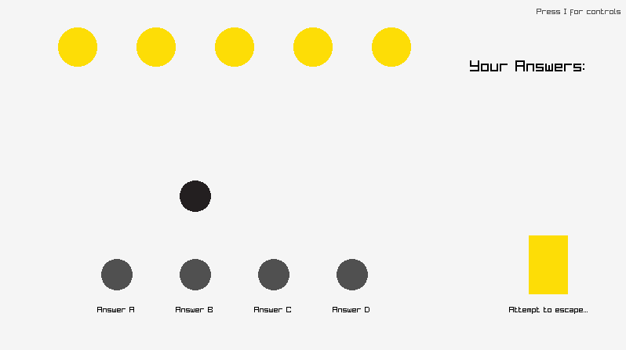

# Escape East College

Escape East College is a 2D trivia escape game built with C++ and raylib.
Move around the room, read the questions, and collect your answers in order.
Reach the exit with the correct sequence to escape.



## How to play

Visit the five yellow question markers and press **E** to read each question.
Move to an **A**, **B**, **C**, or **D** answer marker and press **E** to add
that answer to your inventory.

Answers are stored in the order you collect them, so start with question 1
and work through question 5. Your selections appear on the right side of the screen.

Once you have all five answers, approach the yellow exit and press **E**.
If the sequence is incorrect, press **R** to clear your answers and try again.

| Key | Action |
| --- | --- |
| Arrow keys | Move |
| E | Read a question, collect an answer, or check answers at the exit |
| R | Clear all collected answers |
| Hold I | Show controls |
| Esc | Quit |

## How it works

The game uses raylib for drawing, keyboard input, and collision detection.
Questions and answer markers respond when the player is close enough to interact.

The `Inventory` class stores up to five answers in a `std::queue<std::string>`.
At the exit, it compares the player's answers with the answer key, checking both
the number of answers and their order. The comparison uses copies of the queues,
so checking an answer does not erase the player's inventory.

- `ray_game.cpp` — game loop, movement, question pop-ups, and escape logic.
- `Inventory.hpp` — answer storage, reset, display, and comparison.

## Build and run on Windows

You will need a MinGW-w64 C++ compiler (`g++`) available in your terminal.
Keep `raylib.h`, `raymath.h`, and the `lib` folder alongside the source files.

From the folder containing `ray_game.cpp`, build with:

```powershell
g++ -O3 ray_game.cpp -o tower_climber.exe -static -I. -L./lib -lraylib -lopengl32 -lgdi32 -lwinmm
```

Then run:

```powershell
.\tower_climber.exe
```

The build command links against `lib/libraylib.a`, which must be present
and compatible with your compiler.
